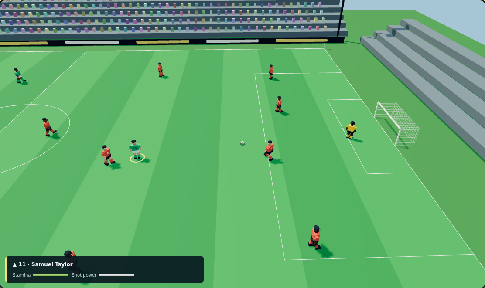

# RWOG 3D football prototype

## Try it

Update `feature/football-3d`, run `npm ci` (new Three.js dependencies), `npm run db:generate` (regenerate the Prisma client after the clean install), then `npm run dev`. Leave Docker/PostgreSQL running. No database migration/reset is needed. Sign in, save a valid starting XI, open **Matches → Play 3D match → Start 3D match**. Select **Close to the action** to inspect the player models, or **Whole pitch** to see the formation. Fullscreen is optional and browser-dependent.

The home side uses all eleven saved XI names and overall ratings in the saved 4-4-2, 4-3-3 or 3-5-2 shape. Ratings currently affect the controlled player’s movement pace. Away players are generic. Three active minutes correspond to 90 match minutes, plus goal/restart pauses. The new mode is an exhibition: browser scores do not change persistent league fixtures, standings, money or transfers. Navigation/reload discards this match.

## Controls

| Action | Keyboard | Pointer / touch | Standard gamepad (experimental) |
|---|---|---|---|
| Move / aim pass | WASD or arrows | Direction buttons | Left stick |
| Sprint | Hold Shift | Hold sprint | RB/R1 or RT/R2 |
| Shield | Hold F | Hold shield | LT/L2 |
| Body feint | Q | Skill | Right-stick click |
| Short pass | P | Pass | A/Cross |
| Through ball | L | Through | Y/Triangle |
| Lofted pass | O | Lob | Keyboard/touch only |
| Charged shot | Hold Space, release | Hold/release shot | Hold/release B/Circle |
| Standing tackle | J | Tackle | X/Square |
| Switch outfield player | C | Switch | LB/L1 |
| Pause | Esc / Pause | Pause | On-screen pause |

Click the pitch to focus keyboard controls. The yellow ground ring and name/stamina panel identify your footballer. Aim passes by holding a movement direction; position and lateral input influence shots. Keepers remain automatic and distribute after gathering the ball. Hiding the tab or losing browser focus pauses. Reset and leaving a progressed match require confirmation. Match sounds are off by default; enabling them adds synthetic shot/goal cues.

## What changed

- Real-time WebGL stadium, striped pitch and markings, goal frames/nets, stands, instanced crowd, lighting and shadows on wider screens.
- Twenty-two procedural 3D human figures with heads, skin/hair variation, jerseys/numbers, shorts, arms, legs and boots. Running, kicking, body-feint and goal celebration poses.
- Following, close and whole-pitch cameras; responsive viewport; optional fullscreen.
- Fixed-step physics: acceleration/deceleration, eight-direction movement, sprint stamina/recovery, solid player separation, shielding/tackling/feints, directional short/through/lofted passes, charged shots, gravity, bounce and rolling friction.
- Opponents press, support, carry and shoot. Goalkeepers track, gather and distribute. Goals, goal pauses and simplified out-of-bounds restarts; final score and shots.
- Graphics-load/context-loss feedback and retry, resource cleanup on closing, simple 2D mode retained.

## Investor walkthrough

1. Show the saved starting XI, then launch the 3D exhibition. Point out a real roster name in the controlled-player panel.
2. Use Close camera to show the articulated footballers and stadium; Start, move diagonally and sprint to show running animation and stamina use.
3. Shield with F, feint with Q, aim a pass with P, try L/O for through/lob, then hold/release Space near the box. Defend with C and J.
4. Pause and switch to Whole pitch; show team shape. Restart if needed and demonstrate pointer controls.
5. Close the match and show that league standings/budget remain unchanged. The league simulator and Ludo still work independently.

## Current limits

This is a stylized, procedural 3D prototype, not console-quality photorealistic football. There are no licensed likenesses/kits, scanned faces, motion-captured locomotion, inverse kinematics, advanced skill chains, replay system, commentary recordings, full crowd animation, online multiplayer, penalties, fouls/cards, offside, substitutions, headers or a full throw-in/corner/goal-kick ruleset. Out-of-bounds restarts are simplified possession changes. Players can overlap slightly during multi-body separation; tackling and keeper logic are basic. No promise is made about console fidelity or competitive balancing.

WebGL2 support is required. GPU performance and Safari/iOS/physical controllers need device testing; the automated browser uses Chromium software rendering. Standard gamepad input is tested with a mock device, not actual console hardware. Sounds are simple synthesized cues, not stadium recordings. Touch controls use pointer events; real multi-touch devices still need testing. No measured frame-rate target is claimed. Low-power devices may need the 2D mode.

## Verification

- `node --test frontend/test/football-3d.test.cjs`: roster/formations; inertia/sprint/immutability; short/through/lob trajectories; shot charge; tackle/shield/feint; body separation/switching; goals and conceding kickoff; high/wide/sideline restarts; keeper distribution; complete match/terminal state; near-box scoring. Goal scenarios start from prepared simulation states. A complete idle match runs in the simulation test.
- `npm run test:3d:browser`: running API/frontend and migrated test database required. It creates an isolated account and exercises real WebGL output, keyboard movement/sprint/charge/actions, pointer buttons, mocked gamepad axes, pause/reset, cameras and three widths, tab hiding, simulated context loss/retry, disposal/close, no game writes, unchanged season/budget, and page/5xx errors. Clock is accelerated. The browser journey does not play a full three-minute match or verify physical controller hardware.
- Existing football management, Ludo and 2D arcade tests remain in CI.

Three.js renderer setup and cleanup follow the [official renderer documentation](https://threejs.org/docs/pages/WebGLRenderer.html). All player/stadium geometry is generated in code; no external character assets are bundled.

Actual Chromium rendering from the browser test:

